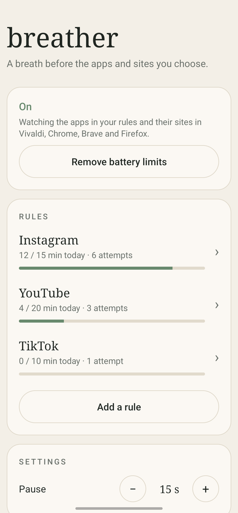
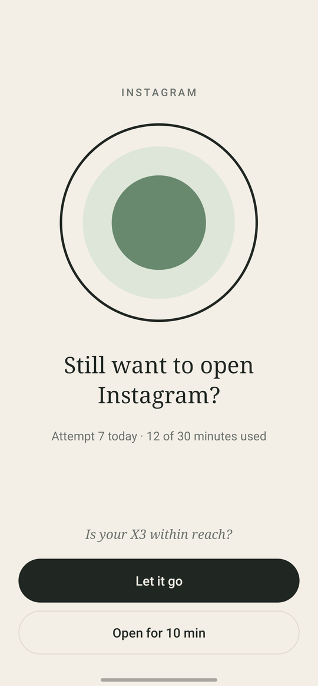
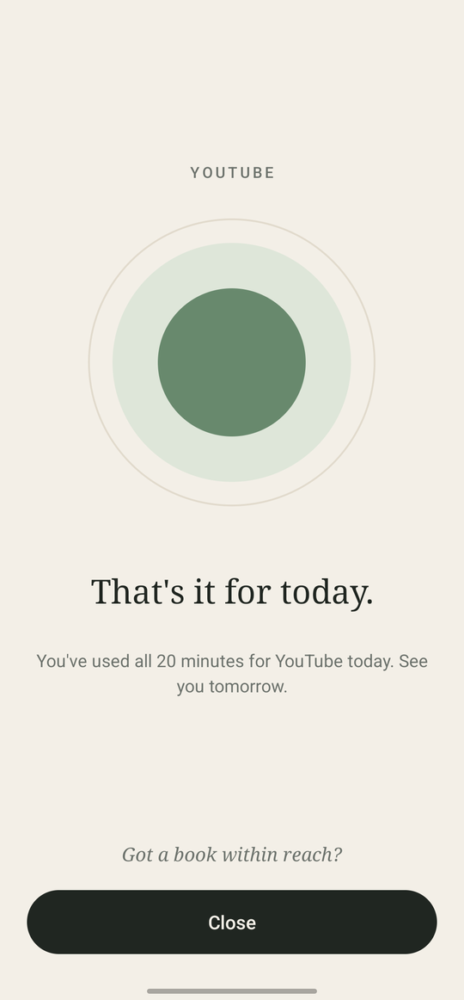
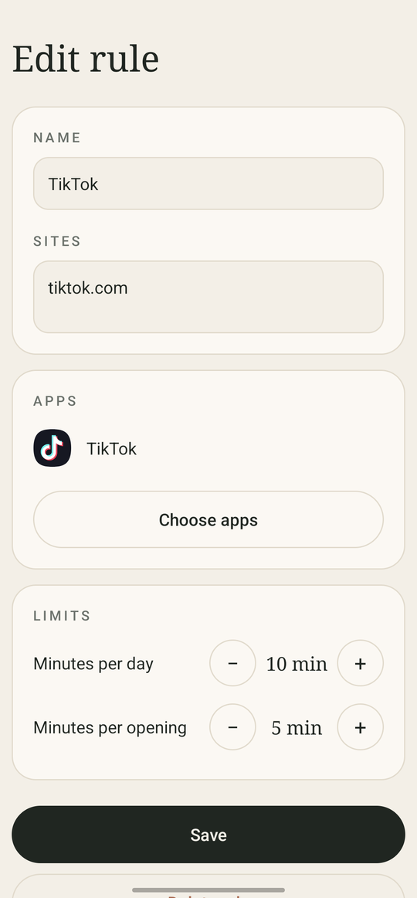

# breather

A small Android app that puts a breathing pause in front of the apps and sites you choose, both in the apps and in the browser. It starts with Instagram and YouTube. Inspired by [one sec](https://one-sec.app).

<p>
  
  
  
  
  
</p>

## How it works

1. You open an app or site from one of your rules. A site counts when it's open in Vivaldi, Chrome, Brave or Firefox.
2. A full-screen pause covers it, and a circle breathes in and out for 15 seconds.
3. The app asks whether you still want to open it, and tells you how many times you tried today.
4. You choose:
   - **Let it go** goes back to the home screen. So does the back key.
   - **Open for 10 min** starts a session. When the session ends, the pause comes back.
5. Time spent in sessions counts against the rule's daily budget. Once the budget is used up, the pause only lets you close.

The counters reset at midnight.

## Rules

A rule has a name, some sites and some apps, plus its own minutes per day and minutes per opening.
- Instagram and YouTube come as the first two rules.
- **Add a rule** creates a new one.
- Tap a rule to edit or delete it.
- Sites also cover their subdomains, so `reddit.com` includes `old.reddit.com`.
- The apps are picked from the installed ones.

The pause length is one setting for all rules.

To recognise the sites, an AccessibilityService reads the browser's address bar. The app doesn't read page content and has no network access.

## Install

Download the APK from the [latest release](https://github.com/daaanny90/breather/releases/latest) and open it on the phone. The app runs on Android 11 and later.

To build it yourself, you need JDK 17 or newer and Android SDK 35:

```sh
./gradlew assembleDebug
adb install app/build/outputs/apk/debug/app-debug.apk
```

Either way, turn the service on: Settings → Accessibility → Installed apps → breather.
- If the switch is greyed out, open App info → ⋮ → Allow restricted settings.
- On Samsung phones, also use the "Remove battery limits" button in the app, otherwise One UI may stop the service.

## Languages

The app is in English and Italian. You can pick the language per app in the system settings.

## Limits

- It adds friction, but it doesn't lock anything: the service can always be turned off in the Accessibility settings.
- Only the four browsers above are covered.
  - The Samsung Internet support is untested.
  - So are links opened in in-app browsers, such as the ones in WhatsApp or Telegram.
- It has been tested on a Galaxy S23 running Android 17.

## License

[GPL-3.0](LICENSE)
