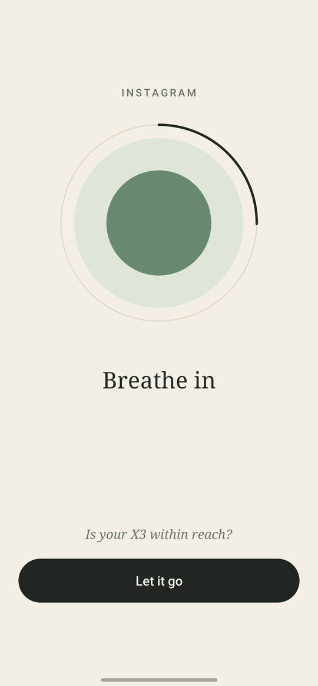

# breather

A small Android app that puts a breathing pause in front of Instagram and YouTube, both in their apps and in the browser. Inspired by [one sec](https://one-sec.app).

<p>
  
  
  
  
</p>

## How it works

1. You open Instagram or YouTube, either the app or the site in Vivaldi, Chrome, Brave or Firefox.
2. A full-screen pause covers it, and a circle breathes in and out for 15 seconds.
3. The app asks whether you still want to open it, and tells you how many times you tried today.
4. You choose:
   - **Let it go** goes back to the home screen. So does the back key.
   - **Open for 10 min** starts a session. When the session ends, the pause comes back.
5. Time spent in sessions counts against a daily budget, 30 minutes by default, shared by both sites. Once the budget is used up, the pause only lets you close.

You can change the pause length, the daily minutes and the minutes per opening in the app. The counters reset at midnight.

To recognise the sites, an AccessibilityService reads the browser's address bar. The app doesn't read page content and has no network access.

## Build and install

You need JDK 17 or newer and Android SDK 35. The app runs on Android 11 and later.

```sh
./gradlew assembleDebug
adb install app/build/outputs/apk/debug/app-debug.apk
```

Then turn the service on: Settings → Accessibility → Installed apps → breather.
- If the switch is greyed out, open App info → ⋮ → Allow restricted settings.
- On Samsung phones, also use the "Remove battery limits" button in the app, otherwise One UI may stop the service.

## Languages

The app is in English and Italian. You can pick the language per app in the system settings.

## Limits

- It adds friction, but it doesn't lock anything: the service can always be turned off in the Accessibility settings.
- Only the four browsers above are covered.
  - The Samsung Internet support is untested.
  - So are links opened in in-app browsers, such as the ones in WhatsApp or Telegram.
- It has been tested on a Galaxy S23 running Android 17.
